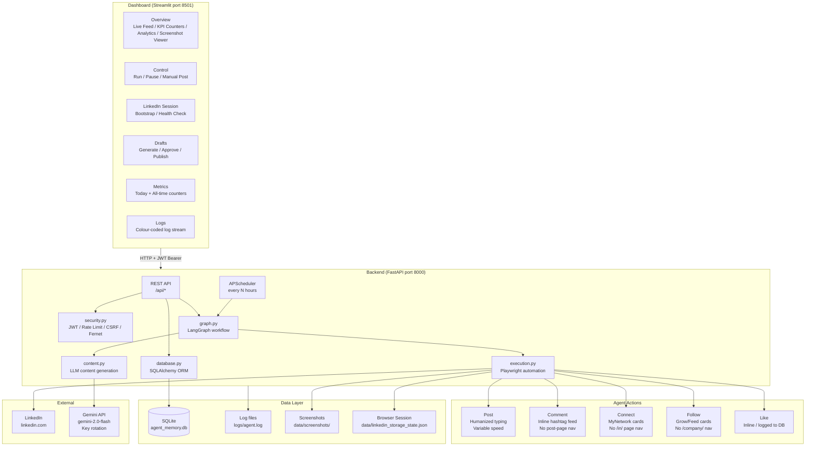

# EduBild LinkedIn Social Agent — v2.0

> **Autonomous, humanized, production-grade LinkedIn automation** for [EduBild](https://www.edubild.com) — the AI-powered platform bridging academia and professional employment.

[](https://python.org)
[](https://fastapi.tiangolo.com)
[](https://playwright.dev)
[](https://streamlit.io)

---

## Table of Contents

1. [System Architecture](#1-system-architecture)
2. [Features](#2-features)
3. [The Humanizer — Implementation Deep Dive](#3-the-humanizer--implementation-deep-dive)
4. [Security — The Unhackable Protocol](#4-security--the-unhackable-protocol)
5. [Setup & Local Deployment](#5-setup--local-deployment)
6. [Cloud Deployment (Docker / Azure)](#6-cloud-deployment-docker--azure)
7. [Environment Variables Reference](#7-environment-variables-reference)
8. [API Reference](#8-api-reference)
9. [Security Audit](#9-security-audit)
10. [Troubleshooting](#10-troubleshooting)

---

## 1. System Architecture



### Data Flow Summary

| Step | Component | Description |
|------|-----------|-------------|
| 1 | Scheduler / Dashboard | Triggers `run_daily_agent_workflow()` |
| 2 | `graph.py` | Orchestrates action sequence: post → discover_and_engage |
| 3 | `content.py` | Generates topic + post text via Gemini |
| 4 | `execution.py` | Opens stealth Playwright browser, loads session |
| 5 | Humanizer | Variable-speed typing, thoughtful pauses, micro-corrections |
| 6 | Actions | Post → Warmup → Inline comment → Feed reset → Connect → Follow → Like |
| 7 | `database.py` | Logs every action with `content_body`, heartbeats |
| 8 | Dashboard | Reads `/api/metrics`, `/api/heartbeat/last`, renders live |

---

## 2. Features

### Core Automation
- **Post** — AI-generated, humanized LinkedIn posts (Gemini + humanizer pass)
- **Comment** — Inline commenting on main feed and hashtag feed cards — never navigates to individual post URLs (avoids CAPTCHA). After each comment the agent navigates back to the feed to fully reset the DOM before moving to the next post.
- **Connection** — Clicks Connect on `/mynetwork/` suggestion cards — no profile page navigation
- **Follow** — Clicks Follow on `/mynetwork/grow/` cards — no company page navigation
- **Like** — Inline like on each post before commenting; logged to DB

### Deduplication
- **In-memory URN set** — post URNs tracked per run; same post never processed twice
- **Text fingerprint** — first 80 chars of post text hashed into `seen_urls`; catches reposts that shift Y position after the comment box opens
- **DB cross-run dedup** — every commented post logged with text-fingerprint key; `was_recently_acted_on()` blocks re-commenting across restarts

### Humanizer
- Variable typing speed (Gaussian inter-key delay: 15–120 ms)
- Thoughtful pauses before/after key actions (800 ms – 5 s)
- Cognitive "reading back" pauses every 40–90 characters (800–1800 ms)
- Occasional micro-corrections (3% per alpha char: wrong key → backspace)
- Post-content Gemini humanizer pass strips AI writing patterns

### Observability Dashboard
- **Live Feed** — scrolling list of last 15 actions with actual content text
- **KPI Counters** — Posts, Comments, Connections, Likes, Follows (today + all-time)
- **Heartbeat Pulse** — animated green dot; turns red and fires STUCK alert if silent > 5 min
- **Action Timeout Detection** — warns if a run exceeds 15 minutes
- **Screenshot Viewer** — browse agent screenshots without leaving the dashboard
- **7-Day Analytics Graphs** — daily activity bar charts + total engagement line chart
- **JWT Login Gate** — dashboard requires authentication before showing any data

### Security
- JWT authentication (HS256, configurable expiry)
- In-memory rate limiting (120 req/min general; 10 req/min on trigger endpoints)
- CSRF token generation and verification
- Fernet symmetric encryption for log content at rest
- Secret scrubbing — API keys never appear in logs
- DOM integrity kill switch — detects unexpected external scripts/iframes

---

## 3. The Humanizer — Implementation Deep Dive

LinkedIn's ML systems analyse typing patterns to distinguish bots from humans. The v2.0 Humanizer operates at three levels:

### Level 1 — Content Humanization (Gemini)

Every AI-generated text passes through a secondary Gemini call with `HUMANIZER_PROMPT`. The prompt removes:

| AI Pattern | What happens |
|------------|--------------|
| "pivotal", "testament", "underscore" | Replaced with plain synonyms or cut |
| Em dash overuse | Replaced with commas/periods |
| Negative parallelisms ("not just X, it's Y") | Rewritten as direct statement |
| Present-participle stacking | Cut or rewritten |
| Sycophantic openers ("Great post!") | Replaced with direct engagement |
| Generic endings ("Exciting times ahead") | Replaced with specific statement |

### Level 2 — Browser Typing Humanization

```python
# backend/agent/execution.py — _human_type()

async def _human_type(page: Page, text: str) -> None:
    chars_since_pause = 0
    next_hesitation_at = random.randint(40, 90)

    for i, ch in enumerate(text):
        # Gaussian inter-key delay: avg 55ms, sigma 22ms, clipped to [15, 120]
        delay_ms = int(max(15, min(120, random.gauss(55, 22))))

        # Cognitive pause after punctuation/space (22% chance, 200-700ms)
        if ch in (" ", ",", ".", "!", "?", "\n") and random.random() < 0.22:
            await page.wait_for_timeout(random.randint(200, 700))

        await page.keyboard.type(ch, delay=delay_ms)
        chars_since_pause += 1

        # Micro-correction: wrong key + Backspace (2.8% per alpha char)
        if ch.isalpha() and random.random() < 0.028:
            wrong = random.choice("asdfghjkl")
            await page.keyboard.type(wrong, delay=random.randint(20, 50))
            await page.wait_for_timeout(random.randint(80, 180))
            await page.keyboard.press("Backspace")

        # Hesitation: "reading back" pause every 40-90 chars (800-1800ms)
        if chars_since_pause >= next_hesitation_at:
            await page.wait_for_timeout(random.randint(800, 1800))
            chars_since_pause = 0
            next_hesitation_at = random.randint(40, 90)
```

### Level 3 — Interaction Rhythm

```
Navigate to feed
    → warmup scroll (30-40 seconds, 10-14 scroll steps)
        → navigate to hashtag feed
            → thoughtful_pause (1.5-5s)
                → like post inline → pause (0.5-1.5s)
                    → click Comment → pause (0.8-2.5s)
                        → _human_type() → pause (1-3s)
                            → submit → navigate back to feed (editor reset)
                                → asyncio.sleep(8-15s)
                                    → next post
```

The 30–40 second main feed warmup before any hashtag/network navigation is critical — without it, LinkedIn fingerprints the session as a bot and CAPTCHAs all subsequent pages.

After each successful comment the agent navigates back to `https://www.linkedin.com/feed/` before continuing. This fully collapses the comment editor, resets layout, and ensures the next post's comment editor is opened fresh with no stale DOM state.

---

## 4. Security — The Unhackable Protocol

### JWT Authentication

```python
# Issue token on login
token = create_access_token({"sub": username})   # HS256, configurable expiry

# Verify on every protected request
payload = verify_token(token)  # Returns None on expiry or tampering
```

The dashboard POSTs credentials to `/api/auth/login`. All subsequent requests include `Authorization: Bearer <token>`.

### Rate Limiting

```
General endpoints:    120 requests / 60 seconds per IP
Trigger endpoints:     10 requests / 60 seconds per IP
  (/api/trigger, /api/runagent, /api/manual/*)
```

In-memory token bucket per IP. Returns HTTP 429 with `Retry-After: 60` when exceeded.

### CSRF Protection

```python
# Server issues token to client
token = generate_csrf_token(session_id=request.client.host)

# Client includes it in mutation requests
valid = verify_csrf_token(token, session_id)  # HMAC-SHA256, 1h TTL
```

Replaying an expired token fails. Tampered tokens fail constant-time comparison.

### Fernet Log Encryption

```python
# Encrypt content_body before storing
encrypted = encrypt_text(content_body)

# Decrypt when reading back
plain = decrypt_text(encrypted)
```

Set `LOG_ENCRYPTION_KEY` in `.env`. Generate with:
```bash
python -c "from cryptography.fernet import Fernet; print(Fernet.generate_key().decode())"
```
Without a key the system operates in plaintext mode (graceful fallback).

### Secret Scrubbing

All log output passes through `scrub_secrets()` which replaces:
- Google/Gemini API keys (`AIza...`)
- Bearer tokens
- `password=...` and `secret=...` field values
- OpenAI-style keys (`sk-...`)

### DOM Kill Switch

```python
# Injected JavaScript checks all script src and iframe src values
findings = await page.evaluate(KILL_SWITCH_JS)
if findings:
    logger.critical("[kill-switch] SUSPICIOUS DOM ELEMENT: ...")
    return True  # abort the action
```

Detects unexpected third-party scripts loaded into the page (XSS / code injection signal).

---

## 5. Setup & Local Deployment

### Prerequisites

- Python 3.12+
- Google Gemini API key(s) — free tier: 1,500 req/day per key
- LinkedIn account (one-time manual login for session bootstrap)

### Step-by-step

```bash
# 1. Clone
git clone https://github.com/your-org/edubild-social-agent.git
cd edubild-social-agent

# 2. Virtual environment
python -m venv venv

# Windows:
venv\Scripts\activate
# macOS/Linux:
source venv/bin/activate

# 3. Install dependencies
pip install -r requirements.txt

# 4. Install Playwright browser
# Windows:
python -m playwright install chromium
# macOS/Linux (includes OS-level deps):
python -m playwright install --with-deps chromium

# 5. Configure environment
cp .env.example .env
# Edit .env — set LLM_API_KEY, DASHBOARD_SECRET_KEY, DASHBOARD_PASSWORD, etc.

# 6. Start backend
# Windows (required — sets ProactorEventLoop before uvicorn starts):
python run_backend.py
# macOS/Linux:
uvicorn backend.main:app --host 127.0.0.1 --port 8000

# 7. Start dashboard (new terminal)
streamlit run frontend/dashboard.py

# 8. Open http://localhost:8501
#    Login with DASHBOARD_USERNAME / DASHBOARD_PASSWORD from your .env

# 9. Bootstrap LinkedIn session
#    Dashboard > LinkedIn Session tab > Bootstrap LinkedIn Session
#    Log in manually in the Chrome window that opens
#    Session saved automatically when feed loads

# 10. Run the agent
#     Dashboard > Control tab > Run Agent Now
#     Watch Overview tab for KPIs, Live Feed, and Heartbeat Pulse
```

> **Windows + Python 3.13 note**: `python run_backend.py` is required on Windows. It sets `WindowsProactorEventLoopPolicy` before uvicorn creates its event loop, which is necessary for Playwright to spawn browser subprocesses. Running `uvicorn` directly will raise `NotImplementedError` on Python 3.13.

### `.env` key settings

```env
# Core
DATABASE_URL=sqlite:///./data/agent_memory.db
AGENT_INTERVAL_HOURS=6
AGENT_DRY_RUN=false
PLAYWRIGHT_HEADLESS=false          # false for local dev; true for cloud/Docker
AGENT_LOG_LEVEL=info

# LLM — add multiple keys for rotation when one hits daily quota
LLM_API_KEY=AIzaXXXXXXXX

# Daily Limits
MAX_LINKEDIN_CONNECTIONS_PER_DAY=20
MAX_LINKEDIN_COMMENTS_PER_DAY=40
MAX_LINKEDIN_POSTS_PER_DAY=10

# Per-run limits
AGENT_MAX_COMMENTS_PER_RUN=2
AGENT_MAX_CONNECTIONS_PER_RUN=2

# Security — change all of these before going to production
DASHBOARD_SECRET_KEY=replace-with-64-char-random-string
DASHBOARD_USERNAME=admin
DASHBOARD_PASSWORD=change-me-now
JWT_EXPIRE_MINUTES=480
CSRF_SECRET=another-random-secret
# LOG_ENCRYPTION_KEY=  # generate with Fernet.generate_key()
```

---

## 6. Cloud Deployment (Docker / Azure)

### Project Docker Files

| File | Purpose |
|------|---------|
| `Dockerfile.backend` | FastAPI + Playwright Chromium (headless) |
| `Dockerfile.dashboard` | Streamlit frontend |
| `docker-compose.yml` | Orchestrates both services with healthcheck and restart |

### Build & Run Locally with Docker

```bash
# Copy and fill in your secrets
cp .env.example .env

# Build and start both services
docker compose up --build -d

# Tail backend logs
docker compose logs -f backend

# Stop everything
docker compose down
```

The backend health endpoint (`GET /api/health`) is used by the compose healthcheck. The dashboard will not start until the backend passes 5 consecutive health checks.

> **LinkedIn session in Docker**: The browser runs headless inside the container and cannot open a visible window for manual login. Bootstrap the LinkedIn session locally first (`PLAYWRIGHT_HEADLESS=false`), then copy `data/linkedin_storage_state.json` to your server before deploying. The `./data:/app/data` volume mount keeps the session file accessible to the container.

### Azure Container Apps (Recommended)

Azure Container Apps is the recommended target — it handles scaling, TLS, and secret management natively.

```bash
# Prerequisites: Azure CLI, Docker

# 1. Login and create resource group
az login
az group create --name edubild-rg --location eastus

# 2. Create Azure Container Registry
az acr create --name eduldindsocial --resource-group edubild-rg --sku Basic
az acr login --name eduldindsocial

# 3. Build and push images
docker build -f Dockerfile.backend -t eduldindsocial.azurecr.io/backend:latest .
docker build -f Dockerfile.dashboard -t eduldindsocial.azurecr.io/dashboard:latest .
docker push eduldindsocial.azurecr.io/backend:latest
docker push eduldindsocial.azurecr.io/dashboard:latest

# 4. Create Container Apps environment
az containerapp env create \
  --name edubild-env \
  --resource-group edubild-rg \
  --location eastus

# 5. Deploy backend
az containerapp create \
  --name edubild-backend \
  --resource-group edubild-rg \
  --environment edubild-env \
  --image eduldindsocial.azurecr.io/backend:latest \
  --target-port 8000 \
  --ingress internal \
  --min-replicas 1 --max-replicas 1 \
  --env-vars PLAYWRIGHT_HEADLESS=true API_HOST=0.0.0.0 \
  --secrets "dashboard-password=<YOUR_PASSWORD>" "llm-api-key=<YOUR_KEY>"

# 6. Deploy dashboard
az containerapp create \
  --name edubild-dashboard \
  --resource-group edubild-rg \
  --environment edubild-env \
  --image eduldindsocial.azurecr.io/dashboard:latest \
  --target-port 8501 \
  --ingress external \
  --min-replicas 1 --max-replicas 1 \
  --env-vars DASHBOARD_API_URL=http://edubild-backend:8000
```

> **Important**: Set `--min-replicas 1 --max-replicas 1` for the backend. The APScheduler and Playwright browser run in-process — multiple replicas would create duplicate schedulers and browser sessions.

### Azure App Service (Alternative)

```bash
az webapp create \
  --resource-group edubild-rg \
  --plan edubild-plan \
  --name edubild-backend \
  --multicontainer-config-type compose \
  --multicontainer-config-file docker-compose.yml
```

### Production Checklist

- [ ] `PLAYWRIGHT_HEADLESS=true` in cloud environment
- [ ] `AGENT_DRY_RUN=false` only after testing with dry run
- [ ] `DASHBOARD_SECRET_KEY` set to 64+ char random string
- [ ] `DASHBOARD_PASSWORD` changed from default (`edubild2024`)
- [ ] `LOG_ENCRYPTION_KEY` set (generate with Fernet)
- [ ] LinkedIn session bootstrapped locally; `linkedin_storage_state.json` uploaded to server
- [ ] Daily limits configured conservatively for new accounts
- [ ] `AGENT_INTERVAL_HOURS` >= 4
- [ ] `./data` volume persisted (SQLite DB + session file)

---

## 7. Environment Variables Reference

| Variable | Default | Description |
|----------|---------|-------------|
| `DATABASE_URL` | `sqlite:///./data/agent_memory.db` | SQLAlchemy DB URL |
| `AGENT_INTERVAL_HOURS` | `6` | Hours between scheduled runs |
| `AGENT_DRY_RUN` | `false` | Skip all real LinkedIn actions |
| `PLAYWRIGHT_HEADLESS` | `true` | Headless browser — must be `true` in Docker/cloud |
| `API_HOST` | `127.0.0.1` | Override to `0.0.0.0` in Docker |
| `API_PORT` | `8000` | Backend listen port |
| `CONTENT_PROVIDER` | `gemini` | LLM provider (`gemini` or `openai_compatible`) |
| `LLM_MODEL` | `gemini-2.5-flash` | Gemini model ID |
| `LLM_API_KEY` | — | Gemini API key |
| `MAX_LINKEDIN_CONNECTIONS_PER_DAY` | `20` | Daily connection limit |
| `MAX_LINKEDIN_COMMENTS_PER_DAY` | `40` | Daily comment limit |
| `MAX_LINKEDIN_POSTS_PER_DAY` | `10` | Daily post limit |
| `AGENT_MAX_COMMENTS_PER_RUN` | `2` | Comments per agent run |
| `AGENT_MAX_CONNECTIONS_PER_RUN` | `2` | Connections per agent run |
| `DASHBOARD_SECRET_KEY` | auto-generated | JWT signing secret — set explicitly in production |
| `DASHBOARD_USERNAME` | `admin` | Dashboard login username |
| `DASHBOARD_PASSWORD` | `edubild2024` | Dashboard login password — change before deploying |
| `JWT_EXPIRE_MINUTES` | `480` | JWT token lifetime |
| `CSRF_SECRET` | auto-generated | CSRF signing secret |
| `LOG_ENCRYPTION_KEY` | — | Fernet key for log encryption at rest |
| `DASHBOARD_API_URL` | `http://127.0.0.1:8000` | Backend URL seen by the dashboard — set to `http://backend:8000` in Docker |

---

## 8. API Reference

### Auth
```
POST /api/auth/login          {"username":"...","password":"..."} → JWT
GET  /api/auth/csrf           → {csrf_token}
```

### Core
```
GET  /api/health              → {status, time_utc}
GET  /api/status              → agent state, scheduler info
POST /api/trigger             → queue agent run
POST /api/runagent            → run synchronously
POST /api/automation/pause
POST /api/automation/resume
```

### Heartbeat
```
POST /api/heartbeat           {action_type, detail} → log heartbeat
GET  /api/heartbeat/last      → {timestamp, action_type, seconds_ago, stuck}
```

### Metrics & Analytics
```
GET  /api/metrics             → today + all_time + recent_actions + drafts
GET  /api/metrics/analytics?days=7 → per-day action counts for charting
```

### Logs & Screenshots
```
GET  /api/logs?limit=300
GET  /api/logs/errors
GET  /api/screenshots         → [{name, size_kb}]
GET  /api/screenshots/{name}  → PNG image
```

### LinkedIn Session
```
GET  /api/linkedin/session/status
POST /api/linkedin/session/bootstrap  {timeout_minutes}
GET  /api/linkedin/session/check
```

### Drafts
```
POST /api/drafts/generate     {topic, audience, tone, length_words}
GET  /api/drafts
PUT  /api/drafts/{id}
POST /api/drafts/{id}/approve
POST /api/drafts/{id}/publish
```

---

## 9. Security Audit

| Threat | Mitigation |
|--------|-----------|
| Unauthorized dashboard access | JWT auth required on all dashboard routes |
| Brute-force login | Rate limiting (10 req/min on auth endpoints) |
| CSRF mutations | CSRF token required; HMAC-SHA256 signed, 1h TTL |
| API key leakage in logs | `scrub_secrets()` replaces all known key patterns |
| Log data exposure | Fernet encryption at rest (opt-in) |
| DOM injection via LinkedIn | Kill switch JS detects unexpected external scripts |
| Session file theft | Stored locally only; never transmitted |
| LinkedIn bot detection | Stealth browser, fixed fingerprint, humanized timing, feed reset between actions |
| JWT replay | 8h expiry; stateless HS256 verification |
| Path traversal (screenshots) | Filename sanitized: `..`, `/`, `\` stripped |

**Periodic checks:**
```bash
pip audit                           # CVE scan
grep -r "AIza" logs/               # API key leak check
grep -r "password" logs/           # Credential leak check
```

---

## 10. Troubleshooting

**`NotImplementedError` on Windows when starting backend**
Python 3.13 on Windows defaults to `SelectorEventLoop` which cannot spawn subprocesses. Use `python run_backend.py` instead of `uvicorn` directly — it sets `WindowsProactorEventLoopPolicy` before uvicorn creates the event loop.

**`[Errno 10048]` — port already in use**
Another backend instance is running. Find and kill it:
```cmd
for /f "tokens=5" %a in ('netstat -aon ^| findstr :8000') do taskkill /F /PID %a
```
Then restart with `python run_backend.py`.

**0 posts collected from feed**
LinkedIn's React DOM uses `data-id="urn:li:activity:XXXXX"`, not `<a href>`. The agent extracts URNs via JS evaluation. If still 0: temporarily set `PLAYWRIGHT_HEADLESS=false` to see what the browser shows. Hashtag fallback (`#ai`, `#edtech`) activates automatically.

**CAPTCHA on hashtag feeds**
Caused by skipped warmup or too many test runs in quick succession. Let the account rest 30–60 minutes.

**Comment posted on wrong post**
Fixed in v2.0 — the agent navigates back to the feed after each comment, fully resetting the DOM. If you see this on an older version, update `execution.py` and restart the backend.

**Gemini quota exhausted mid-run**
The agent automatically rotates across multiple model variants (`gemini-2.5-flash`, `gemini-2.5-flash-lite`, `gemini-3-flash-preview`). If all are exhausted, wait for quota reset (midnight Pacific) or add more API keys.

**Dashboard "Backend unreachable"**
- Local: ensure `python run_backend.py` is running and `DASHBOARD_API_URL=http://127.0.0.1:8000` in `.env`
- Docker: `DASHBOARD_API_URL` must be `http://backend:8000` (service name, not `127.0.0.1`)
- Check: `netstat -an | findstr 8000` (Windows) or `lsof -i :8000` (macOS/Linux)

**Login fails with correct credentials**
Check `DASHBOARD_USERNAME` and `DASHBOARD_PASSWORD` in `.env` and restart the backend. Credentials are read at startup — changing `.env` requires a restart to take effect.

**LinkedIn session expired in Docker**
The session file (`data/linkedin_storage_state.json`) is mounted via volume. Re-bootstrap locally with `PLAYWRIGHT_HEADLESS=false`, then copy the updated file to the server's `data/` directory. No rebuild needed.

---

## License

MIT — see `LICENSE` file.

---

*Built for [EduBild](https://www.edubild.com) — AI-powered career readiness. Winner, Youth Co-Lab Innovation Dialogue (UNDP & Atal Innovation Mission). Bengaluru, India.*
